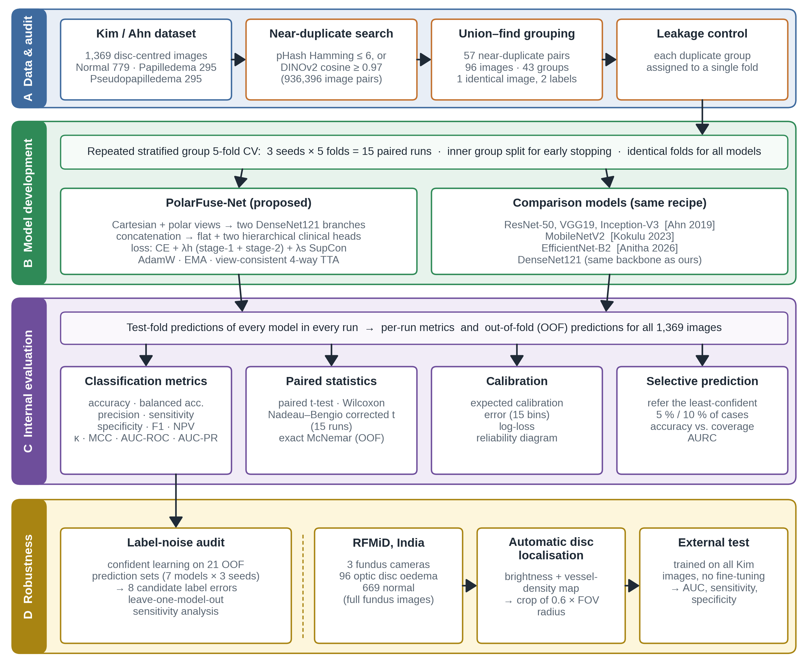
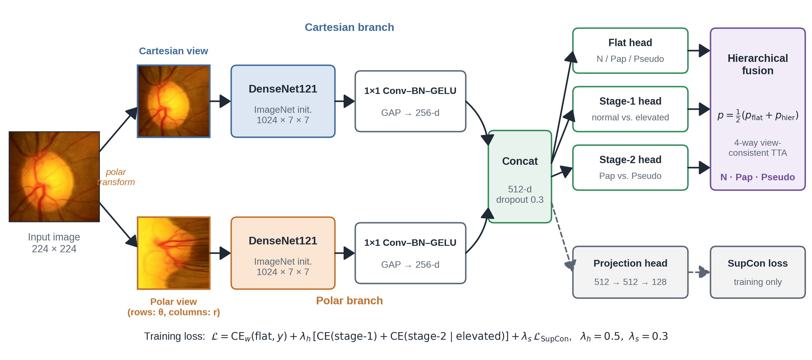

# PolarFuse-Net

**A clinically motivated Cartesian–polar dual-view network for distinguishing papilledema from pseudopapilledema on fundus photographs, with a leakage-audited benchmark and external validation.**

[](https://doi.org/10.5281/zenodo.XXXXXXX)
[](LICENSE)

Asmaa Hekal — Faculty of Computers and Information Systems, Egyptian Chinese University (ECU), Cairo, Egypt
Contact: asmaahekal3@gmail.com · Asmaa.Aboulfadl@ecu.edu.eg

> Paper: *in preparation / under review.* Please cite this repository (see [Citation](#citation)) if you use the code, the benchmark audit or the out-of-fold predictions.



---

## Highlights

* **Benchmark audit.** The public Kim / Ahn pseudopapilledema dataset (1,369 images) contains **57 near-duplicate pairs (96 images, 7%)**, 44 of them inside the pseudopapilledema class, and **one identical image stored with two different labels** (`Normal/452.jpg` = `Pseudopapilledema/149.jpg`). All experiments here use duplicate-aware (group) folds.
* **PolarFuse-Net.** Each disc-centred image is processed in Cartesian form *and* after polar unwrapping by two DenseNet121 branches; the fused descriptor feeds a flat head and two **hierarchical clinical heads** (normal vs. elevated disc → papilledema vs. pseudopapilledema), trained with a supervised contrastive loss.
* **Fair comparison.** The architectures of previous studies (ResNet-50, VGG19, Inception-V3, MobileNetV2, EfficientNet-B2) and DenseNet121 were re-implemented with the *same* data, folds and training recipe.
* **Rigorous evaluation.** Repeated stratified group 5-fold CV (3 × 5 = 15 paired runs), paired t-test / Wilcoxon / Nadeau–Bengio corrected t-test, exact McNemar on out-of-fold predictions, calibration (ECE), selective prediction, confident-learning label-noise audit and **external validation on RFMiD**.



## Main results

Leakage-free repeated stratified group 5-fold cross-validation (15 paired runs, mean ± SD):

| Model | Reported in original paper | Accuracy (%) | Macro-F1 (%) | Macro-AUC (%) | ECE |
|---|---|---|---|---|---|
| ResNet-50 (Ahn 2019; Al-Azzawi 2023) | 98.63 / 98 | 96.10 ± 2.27 | 95.27 ± 2.57 | 99.40 ± 0.58 | 0.103 |
| VGG19 (Ahn 2019) | 96.80 | 97.59 ± 1.07 | 97.04 ± 1.25 | 99.72 ± 0.27 | 0.066 |
| Inception-V3 (Ahn 2019) | 96.45 | 97.28 ± 0.85 | 96.62 ± 0.93 | 99.77 ± 0.18 | 0.065 |
| MobileNetV2 (Kokulu & Göker 2023) | 96 | 97.03 ± 1.75 | 96.39 ± 1.86 | 99.59 ± 0.35 | 0.069 |
| EfficientNet-B2 (Anitha 2026) | 98.55 | 96.91 ± 0.80 | 96.16 ± 1.04 | 99.70 ± 0.19 | 0.066 |
| DenseNet121 | — | 97.57 ± 0.92 | 97.02 ± 1.16 | 99.73 ± 0.28 | 0.062 |
| **PolarFuse-Net (ours)** | — | **97.81 ± 0.92** | **97.26 ± 1.26** | **99.83 ± 0.14** | **0.039** |

* Out-of-fold predictions on all 1,369 images: **98.17 %** accuracy, **99.66 %** papilledema sensitivity; significantly more correct images than 5 of the 6 comparison models (exact McNemar p = 0.0001–0.039).
* Calibration error significantly lower than DenseNet121 (ECE 3.9 % vs 6.2 %, Nadeau–Bengio p = 0.021).
* Referring the 10 % least-confident cases → **99.68 %** accuracy on the remaining 90 %.
* **External validation (RFMiD, India, 3 cameras, no fine-tuning):** optic disc oedema vs normal, AUC **0.953** (95 % CI 0.926–0.974), sensitivity 89.6 %, specificity 90.4 %.

Accuracy differences between models were **not** significant under the conservative Nadeau–Bengio test; the significant advantages are in calibration and on the out-of-fold McNemar comparison. See the paper for the full discussion and limitations.

## Repository structure

```
PolarFuse-Net/
├── notebooks/
│   ├── 01_main_experiments_prior_work_label_noise_external.ipynb   # main results (Parts 0, A–D)
│   ├── 02_external_validation_RFMiD.ipynb                         # external validation only (~40 min)
│   ├── 03_paper_figures_explainability.ipynb                      # paper figures, HiResCAM, hierarchical heads
│   ├── 04_leakage_audit_and_DINOv2_backbone.ipynb                 # audit + DINOv2 backbone + ensemble
│   └── development/                                               # earlier experiments (baselines, 10-model comparison, 12-variant ablation, CV v2)
├── scripts/                     # the same notebooks as plain .py files (jupytext percent format)
├── figures/                     # Fig. 1 overview flowchart, Fig. 2 architecture (PDF vector + PNG 400 dpi)
├── results/
│   ├── main_cv/                 # per-run metrics (15 runs × 7 models), mean ± SD, paired statistics, McNemar
│   ├── oof_predictions/         # out-of-fold probabilities of every model for every seed (1,369 images)
│   ├── audit/                   # near-duplicate pairs, duplicate groups, threshold sensitivity
│   ├── label_noise/             # flagged images and sensitivity analysis
│   ├── external_validation/     # RFMiD results
│   └── ALL_RESULTS_main.xlsx
├── requirements.txt
├── CITATION.cff
├── .zenodo.json
└── LICENSE
```

## Data

| Dataset | Use | Source |
|---|---|---|
| Kim / Ahn pseudopapilledema dataset (1,369 images: 779 normal, 295 papilledema, 295 pseudopapilledema) | development, cross-validation | [Kaggle](https://www.kaggle.com/datasets/shashwatwork/identification-of-pseudopapilledema) · [OSF](https://osf.io/2w5ce/) · Ahn et al., *BMC Ophthalmol.* 2019 |
| RFMiD 1.0 (optic disc oedema n = 96, normal n = 669) | external validation | [Kaggle](https://www.kaggle.com/datasets/andrewmvd/retinal-disease-classification) · Pachade et al., *Data* 2021 |

No data are redistributed in this repository; only derived results (predictions, metrics, file names) are included.

## How to reproduce (Kaggle, no installation needed)

1. Create a new Kaggle notebook → **File → Import Notebook** → choose a notebook from `notebooks/`.
2. **Add Data:** `identification-of-pseudopapilledema` (shashwatwork). For external validation also add `retinal-disease-classification` (andrewmvd).
3. **Settings:** Accelerator = GPU (T4 or P100), Internet = On.
4. **Save Version → Save & Run All (Commit).** The main notebook takes ≈ 7 h on a T4; it has a time guard and always writes a results zip.
5. Download the results zip from the **Output** tab.

All runs use fixed seeds (42, 7, 2024); repeated runs of the same configuration gave identical predictions.

## Citation

If you use this code, the audit or the predictions, please cite:

```bibtex
@software{hekal_polarfusenet_2026,
  author    = {Hekal, Asmaa},
  title     = {{PolarFuse-Net}: Cartesian--polar dual-view network for papilledema vs. pseudopapilledema, with a leakage-audited benchmark (code)},
  year      = {2026},
  version   = {1.0.0},
  publisher = {Zenodo},
  doi       = {10.5281/zenodo.XXXXXXX},
  url       = {https://doi.org/10.5281/zenodo.XXXXXXX}
}
```

The journal article will be added here when published.

## License

Code: [MIT License](LICENSE). The datasets are subject to their own licences.
